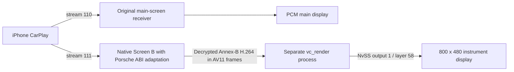

# PCM 4.1 CarPlay instrument-cluster video

**2026-11-16: the owner confirmed dual-screen CarPlay working on this Porsche PCM 4.1 / MHI2 US POG24 P3645 / MU0935.** Target logs independently show the iPhone's second video stream being received and forwarded to a separate instrument-cluster renderer. This is a successful experiment on one unit, not a generally compatible release.

The working case was a complete PCM restart with the iPhone already connected. Unplug/reconnect exposed a separate lifecycle problem. A monitor correction was subsequently installed, but repeatable hot-plug recovery is **not yet confirmed**. The owner's final confirmation establishes dual-screen playback, not every reconnect scenario.

## Reference projects

- [joeyQuery/MHI2-altScreen](https://github.com/joeyQuery/MHI2-altScreen), examined at commit `6ff7ca40107fb27126fef7fb0c5023252d610871`: the main implementation reference, particularly its Audi B9 Harman MHI2 MU0678/P3241 native Screen B receiver and independent `vc_render` process.
- [moldovanugeorge/mh2p-cluster-Porsche](https://github.com/moldovanugeorge/mh2p-cluster-Porsche) and [fifthBro/mh2p-cluster](https://github.com/fifthBro/mh2p-cluster): initial PCM5/MH2P references. They were not copied directly into this PCM4 unit.

This work demonstrates a video path to the instrument display. It does not establish full BAP navigation integration, steering-wheel map interaction, Android Auto support, or compatibility with every iPhone navigation application.

## Working video path



The preload hook advertises an additional display and uses the stock AirPlay implementation for the second screen's receive and security path. Screen B forwards video to a loopback socket; its decoder lives in a separate process. Main-screen decode callbacks continue to call the original implementation. Keeping the second NvSS instance outside `dio_manager` follows the upstream design intended to avoid interfering with the main decoder's close path.

On this unit, the display-manager command addresses the cluster as display **4**; the status listing calls it `display1`. Native map context is **72**, and the tested secondary-video context is **76**, containing layer **58**. The main display remained in CarPlay context **78** during the simultaneous synthetic-video test.

The monitor switches to context 76 only after the renderer reports successful decoding with an IDR received. It restores context 72 on disconnect, decoder failure, or eight unchanged one-second heartbeat checks. A heartbeat reflects decode activity; it is not a separate measurement of panel presentation.

## Why the Audi binary was not used unchanged

The examined Porsche AirPlay library has SHA-256:

`6b96562897e58bab3f55705db775587e9ca65bc1617d093051cfd5576312c562`

Static analysis and target preflight established these Porsche-specific values:

| Item | P3645 value |
| --- | --- |
| Video implementation namespace | `dio::NvssVideoImpl` |
| `AirPlayReceiverSessionScreen_Create` | `0x27354` |
| `ScreenStreamCreate` | `0x7e69c` |
| Stock screen worker | `0x20bb8` |
| NTP callback | `0x20ef0` |
| Up-ticks callback | `0x20ee4` |
| Video vtable pointer target | `0xa7f40` |
| Session socket-family / UUID / device-ID offsets | `0x55` / `0x70` / `0x88` |
| Session server / clock offsets | `0x0c` / `0x13d0` |
| Server screen-config / frames-config offsets | `0xd0` / `0xc8` |
| Time-sync argument order | session, NTP callback, up-ticks callback |

The runtime preflight checks native-B function-entry instruction patterns, vtable interposition, and all five direct-hook prologues before patching executable pages. This is a limited ABI gate, not a substitute for checking the exact firmware input hash and testing the device.

Additional adaptation included:

- Cluster geometry of 800x480; the existing main-screen widescreen JAR was retained.
- Audi-specific HID/zoom behavior and the upstream in-hook renderer-launch scripts disabled for this trial.
- Parameter-set replay on renderer reconnect, and codec-cache reset for a new phone session.
- Continued rejection of dependent frames until an IDR arrives. A regression test exposed upstream behavior that released that gate after three unsuccessful keyframe requests.
- An independent supervisor instead of spawning display-control helpers during teardown.
- An atomic renderer heartbeat under `/ramdisk`; the first attempt to rename it under this target's `/tmp` did not produce the destination file.
- Removal of assumptions that `nohup` and `rmdir` were available on the head unit.

The local build used Clang for ARM objects and QNX6.5 headers, linker, libc, and socket library. Linking disallowed undefined references. QNX cache invalidation and the required ARM memory-helper compatibility functions were supplied explicitly. The older linker emitted an ARM EABI attribute34 warning; both resulting programs were subsequently executed on the target.

## Evidence and failure chronology

| Check | Observed result |
| --- | --- |
| Native C parsing/framing/routing tests | Seven groups passed with ASan/UBSan, including malformed inputs and main/secondary routing isolation |
| Exact-firmware ABI regression checks | Six passed against the private backup ELF |
| Supervisor shell tests after reconnect correction | Six passed |
| Disabled preload and isolated hook installation | Loaded on QNX; all five hooks installed; native-B ABI/interposition preflight passed |
| New renderer on the actual unit | Two 150-frame synthetic runs, zero decode errors |
| Automatic display lifecycle | A separate 60-frame run switched context 72 to76 and back to72, with main CarPlay still in context 78 |
| iPhone second stream after complete restart | Approximately 25-28 fps; no forwarding drops in sampled counters |
| Complete successful session before unplug | Renderer reported `frames=5209 dec_err=0` |
| Owner confirmation | Explicitly confirmed dual-screen success |
| Repeated real-phone unplug/reconnect | Still needs confirmation with the corrected monitor |

Before the successful complete restart, two warm launches exited about ten seconds after starting. The integrator configuration has `startupTimeout=10000`, but matching timing does **not** prove the underlying cause. The same installed video binaries subsequently received stream111 successfully after reboot.

The successful session's unplug sequence is more specific:

```text
217.988  TEARDOWN entry request=NULL reason=-6753
218.011  whole-session -> private111 cleanup
218.061  renderer: hook disconnected frames=5209 dec_err=0
218.347  NvSSVideoClose returned 0
219.350  renderer exited
```

There was no subsequent phone-gone-marker or cleanup-completion line in the captured hook log. The supervisor treated the missing marker as an unexpected owner exit and created a per-boot fallback flag. That flag causes subsequent launches to run original CarPlay without the second-screen preload. Reboot clears the RAM flag, which can make cold start work again without proving that native teardown itself is correct.

**Monitor correction installed:** record the count of whole-session `TEARDOWN` lines at supervisor startup, then check whether that count increased before owner exit. A new teardown record also establishes an expected disconnect; old records alone do not. Unexplained exits still fall back. This fixes the observed misclassification, but does not yet explain why the synchronous teardown stopped before its next expected log.

The updated script was installed after preserving its previous contents and hashes. The later owner confirmation was recorded as dual-screen success; it was not specific enough to certify repeated hot-plug recovery.

## Installed trial and recovery

The trial uses a shell wrapper at the original `dio_manager` path, with the exact original executable retained as `dio_manager.pcm4-stock`. The wrapper executes that original binary with or without the preload. **The `.pcm4-stock` process name alone does not identify fallback mode**; active hook logs, second-stream counters, and renderer state distinguish the modes.

Supporting files live under `/mnt/app/root/pcm4cluster`. The original smartphone-integrator configuration and existing widescreen/audio/steering-wheel JARs were preserved. The application mount was returned to read-only after writes.

Recovery files were independently read back and hashed, with primary backups kept on the owner's internal C: drive. Raw device logs, OEM executables/libraries, credentials, and generated target binaries remain private and are not included in this repository.

The installed trial's restore helper is:

```sh
/bin/sh /mnt/app/root/pcm4cluster/rollback.sh
```

It restores the preserved executable for subsequent launches and returns the cluster to the native map. Reconnecting the phone or restarting PCM is needed to replace a currently running modified process. The helper is specific to this installation and is not a universal recovery command.

A generic QNX reboot command was also tried during this investigation. It closed applications and disconnected SSH, followed by a longer black-screen interval before the owner reported startup. It should not be described as an established quick PCM reset procedure.

## Remaining work

- Verify multiple phone unplug/replug cycles without restarting PCM, with the updated supervisor actually running.
- Determine why the captured native teardown ends immediately after entering full-session cleanup.
- Distinguish the earlier ten-second warm-start failures from the later false-fallback classification.
- Check long-duration operation, app/navigation transitions, and startup with the phone initially disconnected.

Preserve the working video binaries while investigating lifecycle behavior. The successful playback path and unverified reconnect behavior are separate results.
